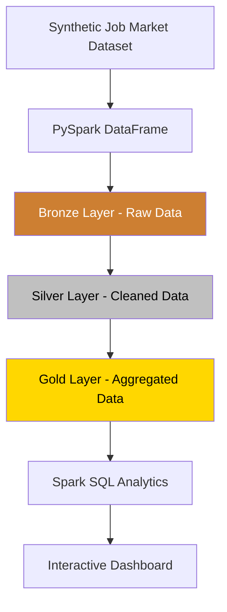

# Intelligent Job Market Analytics Pipeline using Databricks

## Project Overview

This project demonstrates an end-to-end data engineering
and analytics pipeline using Databricks, PySpark,
Spark SQL, Delta Lake, and Medallion Architecture.

The pipeline processes 5,000 synthetic job market
records to analyze technical skills, salary patterns,
job opportunities, companies, experience levels,
and work mode distributions.

## Technologies Used

- Databricks Free Edition
- Python
- PySpark
- Apache Spark
- Spark SQL
- Delta Lake
- Unity Catalog
- Medallion Architecture
- Databricks AI/BI Dashboard
- GitHub

## Project Architecture



## Dataset Information

| Attribute | Value |
|---|---|
| Total Records | 5,000 |
| Original Columns | 9 |
| Bronze Layer Columns | 11 |
| Silver Layer Columns | 13 |
| Companies | 10 |
| Job Roles | 7 |
| Locations | 7 |
| Data Source | Synthetic Dataset |

## Medallion Architecture

### Bronze Layer

- Generated 5,000 synthetic job records using Python.
- Created a PySpark DataFrame.
- Added ingestion timestamps and source metadata.
- Stored raw records as a Delta Lake table.

### Silver Layer

- Checked missing values.
- Implemented duplicate removal.
- Validated salary values.
- Standardized text columns.
- Converted date fields into date format.
- Transformed technical skills into arrays.

### Gold Layer

Created six business-ready aggregated tables:

- Skills Demand
- Salary Analysis
- Location Analysis
- Company Analysis
- Experience Analysis
- Work Mode Analysis

## Delta Lake Tables

| Table | Layer |
|---|---|
| jobs_bronze | Bronze |
| jobs_silver | Silver |
| skills_demand | Gold |
| salary_analysis | Gold |
| location_analysis | Gold |
| company_analysis | Gold |
| experience_analysis | Gold |
| work_mode_analysis | Gold |

## Key Project Features

- End-to-end batch ETL pipeline
- Data cleaning and validation
- Persistent Delta Lake tables
- PySpark data transformations
- Spark SQL analytical queries
- Technical skill demand analysis
- Salary comparison across job roles
- Location-based job analysis
- Company-wise job distribution
- Interactive dashboard with 12 components

## Dashboard KPIs

| Metric | Result |
|---|---:|
| Total Job Postings | 5,000 |
| Total Companies | 10 |
| Total Job Roles | 7 |
| Total Locations | 7 |
| Average Annual Salary | 14.09 LPA |

## Sample Analytical Insights

Based on the generated synthetic dataset:

- SQL appears in 2,602 job postings.
- Python appears in 2,591 job postings.
- ML Engineer has an average salary of 14.46 LPA.
- Bangalore contains 734 job postings.
- Remote work represents 35% of the records.
- The 2-5 years experience category contains
  1,699 job postings.

## Dashboard Screenshots


## Repository Structure

```
databricks-job-market-analytics/
|
|-- 01_Job_Market_Data_Ingestion.py
|-- 02_Job_Market_Data_Transformation.py
|-- 03_Job_Market_Business_Analytics.py
|-- 04_Job_Market_SQL_Analytics.py
|-- Dashboard screenshots
|-- README.md
|-- LICENSE
```

## How to Run the Project

1. Create a Databricks Free Edition account.
2. Download or clone this repository.
3. Import the four notebooks into Databricks.
4. Connect to Serverless compute.
5. Ensure the workspace catalog is accessible.
6. Execute the notebooks in numerical order.
7. Verify the Bronze, Silver and Gold tables.
8. Create a Databricks dashboard using SQL datasets.
9. Configure the KPI cards and visualizations.

## Skills Demonstrated

- Data Engineering
- ETL Pipeline Development
- Data Cleaning and Transformation
- Distributed Data Processing
- PySpark Programming
- SQL Analytics
- Delta Lake
- Data Visualization
- Medallion Architecture

## Future Enhancements

- Integration with real-world job posting datasets
- Automated workflow scheduling
- Incremental data ingestion
- Advanced data quality monitoring
- Machine learning-based salary prediction
- Skill recommendation system

## Data Disclaimer

This project uses synthetically generated job postings,
company assignments, salaries, and experience levels.

The results are intended for educational and portfolio
demonstration purposes only and do not represent actual
job vacancies, company hiring activity, or market salaries.

## License

This project is licensed under the MIT License.
